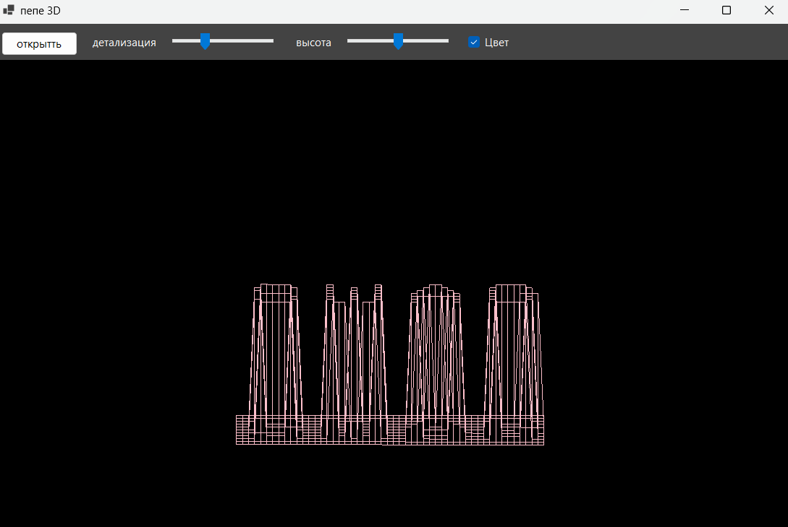
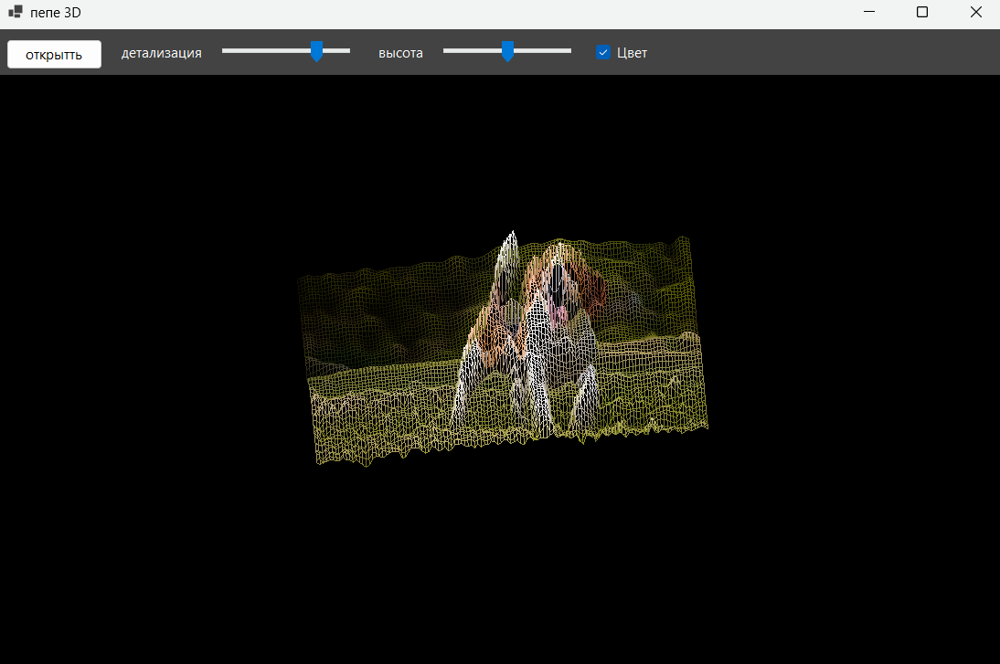

# 3Dshtuka
программа на C#, преобразует картинку/fdf в 3D объект
3Д картинка, воркает норм

чем светлее участок картинки, тем выше он поднят.

яркость - 0.299*R + 0.587*G + 0.114*B
строки - столбцы * высота картинки / ширина картинки

чтобы повернуть точку на угол a:

x1 = x*cos(a) - y*sin(a)
y1 = x*sin(a) + y*cos(a)

чтобы посмотреть на рельеф(ну или горы) - наклоняем на угол b:

y2 = y1*cos(b) - z*sin(b)

числа в пиксели экрана:

i = половина ширины монитора + x1 * масштаб
j = отступ для панельки с кпонопками + половина высоты монитора + y2 * масштаб

скрины: 

